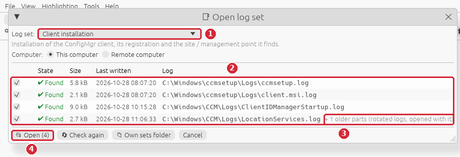
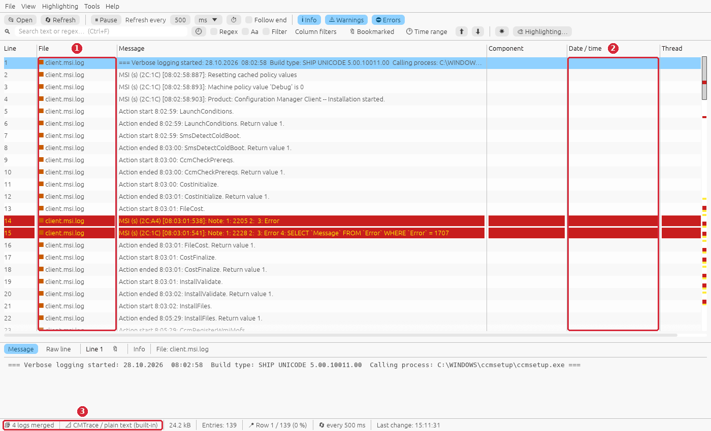
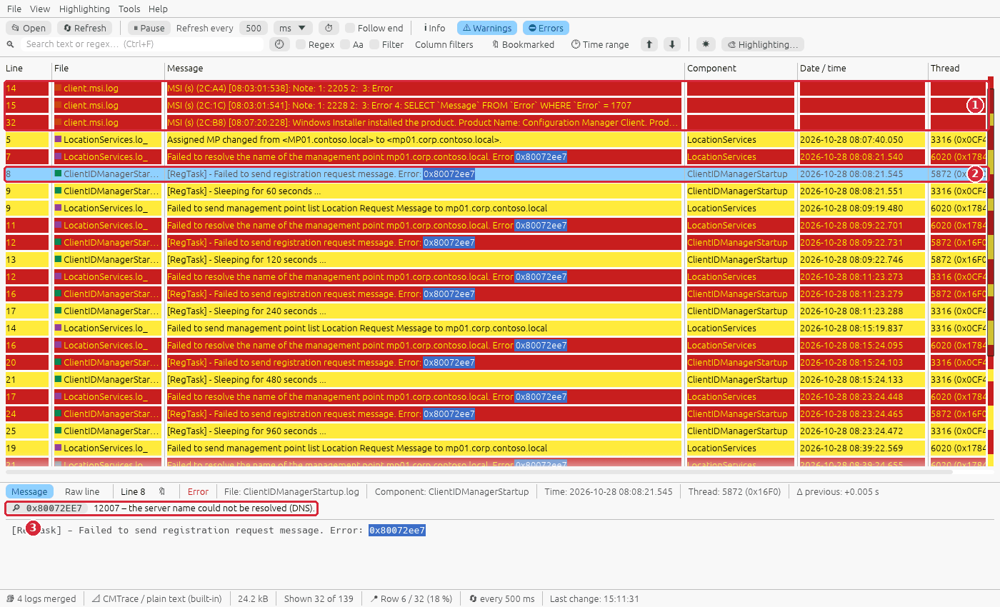
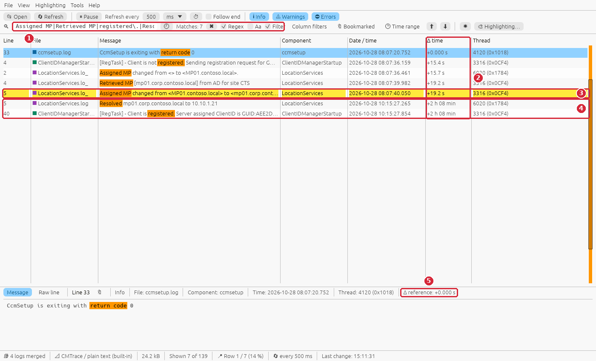
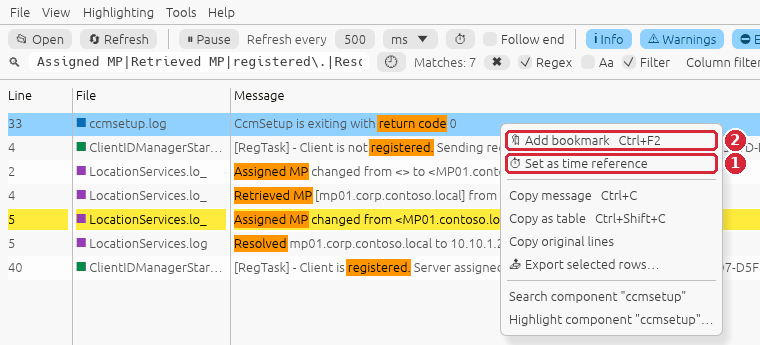
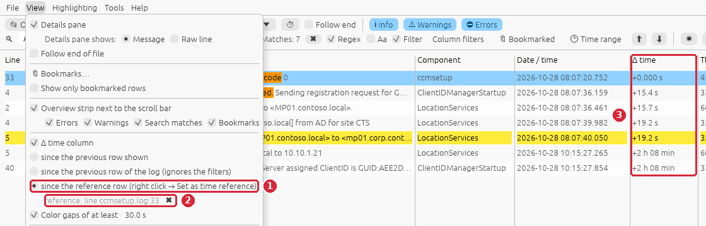
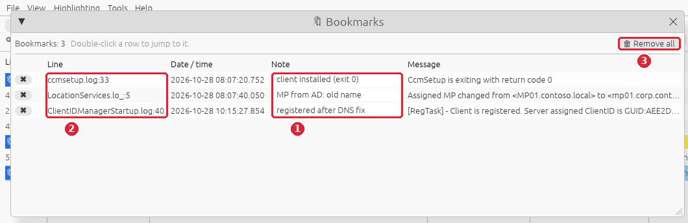
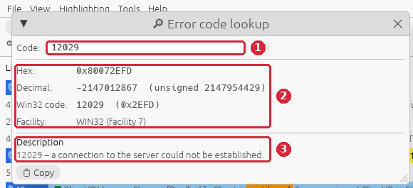

# Guide: a new ConfigMgr client does not register

**Situation:** you installed the ConfigMgr client on a computer (manually with `ccmsetup.exe`,
by client push or in a task sequence). ccmsetup reported success, but the device stays
**inactive / without client** in the console, gets no policies and Software Center is empty.
You want to know whether the **installation** or the **registration** failed, which
**management point** the client talks to and **why** it cannot reach it.

**You need:** RusTrace 1.0 or newer and access to the client's logs (locally, or over
`\\<computer>\admin$` with admin rights).

> The screenshots use invented sample logs. To follow the guide on your own PC, create them with
> `python scripts/gen_guide_logs.py client-install` (written to `testlogs\guides\client-install\`)
> and open the five files with **File → Open…**.

## The logs involved

| Log | What it tells you |
|---|---|
| `C:\Windows\ccmsetup\Logs\ccmsetup.log` | The bootstrapper: command line, which management point / source it downloads from, prerequisites, `client.msi` and the **return code** of ccmsetup. |
| `C:\Windows\ccmsetup\Logs\client.msi.log` | The verbose Windows Installer log of the client itself – only needed when the MSI part fails. |
| `C:\Windows\CCM\Logs\ClientIDManagerStartup.log` | The client identity and its **registration** with the site (`[RegTask]`): sent, pending, registered – or the error and the next retry. |
| `C:\Windows\CCM\Logs\LocationServices.log` | Site assignment and **management point lookup**: from the command line, Active Directory, DNS or the MP list; the AD site of the computer. |

`ccmsetup.log` return codes: **0** success, **6** error, **7** reboot required, **8** setup already
running, **9** prerequisite evaluation failure, **10** setup manifest hash validation failure.
A return code 0 only says that the *installation* worked – registration comes after it.

## Step 1 – Open the logs

**File → Open log set…**



1. **Log set:** *Client installation* (*This computer*, or *Remote computer* and the name).
2. All four logs are found, with their size and last write time. A log that was last written
   long before the installation belongs to an older attempt.
3. **+ 1 older parts** – `LocationServices.log` was rotated (the client renames a full log to
   `LocationServices.lo_`); the older part is opened with it automatically, so nothing from the
   start of the installation is missing.
4. **Open (4)**.

## Step 2 – The MSI log in the merged view

The lines of the verbose MSI log have only a time (`[08:02:58:887]`, `Action start 8:02:59:`); the
date is in its first line `=== Verbose logging started: 28.10.2026  08:02:58 …`. The built-in log
definition *Windows Installer log (MSI)* (`msi.log.def`, #40) takes the date from that line, so
the rows of `client.msi.log` stand **at their real time** – between 08:02:58 and 08:07:20, after
ccmsetup downloaded `client.msi` – and the status bar shows *Several formats* (CMTrace + MSI).
The table gets the columns **MSI** (`s` server / `c` client process) and the process:thread in
**Thread**.



The screenshot is from an older version, which read the MSI log as plain text:

1. The **File** column: rows of `client.msi.log` stood **at the top** of the merged view …
2. … because without a date RusTrace could not place them in time (rows without a date/time stay
   in the order of their own log, before the dated rows). Other plain-text logs with times only
   still behave like this – a log definition with `header.date` fixes it ([Log
   definitions](../log-definitions.md)).
3. The status bar: **4 logs merged**.

You do not need to untick **Follow end**: as soon as you select a row, following the end is
paused (orange checkbox, *⏸ Follow end paused* in the status bar) and the view stays where you are.
Press **Esc** or **End** when you want to follow the newest rows again.

## Step 3 – Errors and warnings

Turn **Info** off. Click an error row:



1. No errors of `client.msi.log`: the MSI definition marks only real failures (`Return value 3`,
   `Error 1722.`, `returned actual error code`, `error status: 1603` …). The two
   `Note: 1: 2205 … 3: Error` lines are **harmless** (Windows Installer looks up an optional
   table – they appear in almost every MSI log) and the line `Windows Installer installed the
   product … Installation success or error status: 0` is **success**. The screenshot is from an
   older version that marked these three lines because the word *error* is in them. So the MSI
   part is fine.
2. The real problem: `[RegTask] - Failed to send registration request message. Error:
   0x80072ee7`, together with `LocationServices` *Failed to resolve the name of the management
   point mp01.corp.contoso.local*, repeated.
3. The details pane explains the code: **12007 – the server name could not be resolved (DNS)**.

Between the errors the warnings `[RegTask] - Sleeping for 60 seconds`, `120`, `240`, `480`,
`960`, `1920 seconds` show that the client keeps trying, with a longer wait every time (up to
32 minutes). It does not give up – it registers on its own once the cause is gone.

## Step 4 – Read the story of the installation

Turn **Info** on again and search for the milestones. Type into the search field and tick
**Regex** and **Filter**:

```
Assigned MP|Retrieved MP|registered\.|Resolved|return code
```

Then right-click the `CcmSetup is exiting with return code 0` row → **Set as time reference**
(step 5) – this also turns the **Δ time** column on:



1. The regular expression (`|` = or) with **Regex** and **Filter** on – only the 7 milestone rows
   of all four logs stay.
2. The **Δ time** column relative to the end of ccmsetup.
3. **The cause:** 19 s after the installation the client asked Active Directory for its
   management point and changed it from `MP01.contoso.local` (given on the ccmsetup command line)
   to **`mp01.corp.contoso.local`** – the name the site publishes in AD (here an old DNS suffix
   that no DNS server resolves any more).
4. **2 h 08 min later** the name was resolved (after a DNS record was added) and the client
   registered right away.
5. The details pane shows the Δ to the reference row too.

So the installation was fine, the problem is the **management point name published in AD**
(the FQDN of the MP site system / its DNS suffix), not the client.

## Step 5 – Time reference and Δ time



1. **Set as time reference** – the Δ column then counts from this row (rows before it are
   negative). Useful to answer "how long after the installation …?"
2. **Add bookmark** (Ctrl+F2) – mark the rows you want to come back to (step 6).



1. **View → since the reference row** – setting a reference switches to this mode and shows the
   Δ column; the other modes (since the previous row shown / of the log) are in the same menu.
2. The reference row with its file and line; ✖ removes it.
3. The **Δ time** column.

## Step 6 – Bookmarks with notes

Bookmark the three key rows (Ctrl+F2) and type a note next to 🔖 in the details pane. Click
**🔖 3** in the status bar (or **View → Bookmarks…**):



1. Your **notes** – they are also the tooltip of the line number in the table.
2. File and line of every bookmark – double-click a row to jump to it, even after the filter
   changed.
3. **Remove all**.

Bookmarks stay on their log lines when the logs grow or rotate, and they can be exported with
their context (**File → Export highlighted rows with context…** → *Bookmarked rows*).

## Step 7 – Look up related codes

Registration and download problems usually come with WinINet / WinHTTP codes. **Tools → Error
code lookup** (Ctrl+E) explains any of them – hex, negative decimal or the short number:



1. Type the code, e.g. `12029`.
2. All forms of the code: `0x80072EFD`, `-2147012867`, Win32 `12029`, the facility.
3. The description: *a connection to the server could not be established*. **Copy** puts it
   into the clipboard for your ticket.

## Command line

```bat
:: All client installation logs, merged, only errors and warnings
rustrace.exe C:\Windows\ccmsetup\Logs\ccmsetup.log C:\Windows\CCM\Logs\ClientIDManagerStartup.log C:\Windows\CCM\Logs\LocationServices.log --warnings

:: The milestones of the installation and registration
rustrace.exe C:\Windows\ccmsetup\Logs\ccmsetup.log C:\Windows\CCM\Logs\ClientIDManagerStartup.log C:\Windows\CCM\Logs\LocationServices.log --search "Assigned MP|Retrieved MP|registered\.|Resolved|return code" --regex --filter

:: ccmsetup on a remote computer, straight at its return code
rustrace.exe \\PC0815\admin$\ccmsetup\Logs\ccmsetup.log --search "exiting with return code"
```

`--warnings` shows errors and warnings (like turning Info off). With a log set you do not need to
know the paths: **File → Open log set… → Client installation**.

## What to look for

| In the logs | Meaning | Next step |
|---|---|---|
| ccmsetup `return code 0`, then `[RegTask] … Failed to send registration request` | Installed, but cannot reach the management point | LocationServices.log: which MP, can it be resolved / reached |
| `0x80072ee7` (12007) | The MP name cannot be resolved | DNS record of the MP; the FQDN the site publishes in AD (*Site system properties*) and the client's DNS suffix |
| `0x80072efd` (12029), `0x80072ee2` (12002) | No connection / timeout to the MP | Firewall, ports 80 / 443 (or the custom ports), proxy, IIS on the MP |
| `Assigned MP changed from <…> to <…>` | The client switched to another MP (AD, MP list) | Is the new name the one you expect? |
| `Client is not registered … Approval status 0` | Registered, but not approved | Approve the client in the console, or the site's approval setting |
| `Current AD site of machine is …` + no MP for the site | Boundary / boundary group missing for the client's network | Boundaries and boundary group of the AD site / IP range |
| ccmsetup `return code 7` | Reboot required | Restart, ccmsetup continues afterwards |
| ccmsetup `return code 9` | A prerequisite failed | ccmsetup.log above the return code: the failed prerequisite (e.g. .NET, Windows version) |
| ccmsetup `return code 10` | Manifest hash validation failed | Download source corrupted / altered; redistribute the client package |
| client.msi.log `Return value 3`, `0x80070643` | MSI 1603 – the client MSI failed | The lines just above the first `Return value 3` in client.msi.log |
| `Note: 1: 2205 2: 3: Error` in an MSI log | Harmless lookup of an optional MSI table | Nothing – ignore it |

## Summary

| Step | What | Shortcut |
|---|---|---|
| 1 | File → Open log set… → *Client installation* | – |
| 3 | Info off – registration errors (MSI notes are not errors) | – |
| 4 | Regex search of the milestones + Filter | Ctrl+F, Ctrl+L |
| 5 | Set as time reference, Δ time column | right-click |
| 6 | Bookmarks with notes, bookmarks list | Ctrl+F2, F2 |
| 7 | Error code lookup | Ctrl+E |
