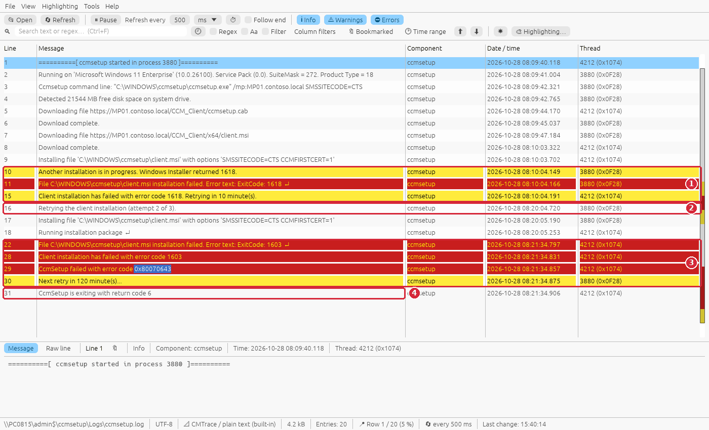
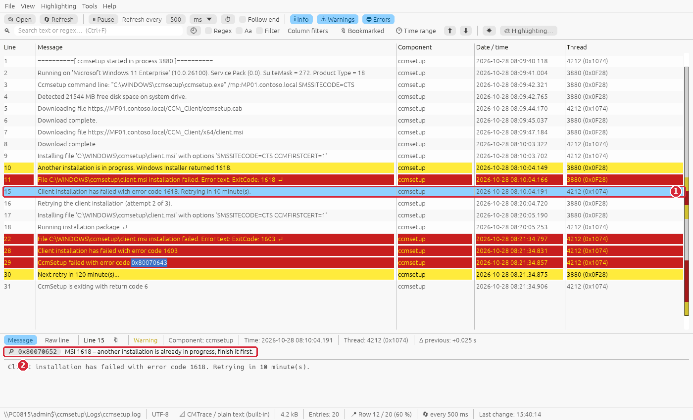
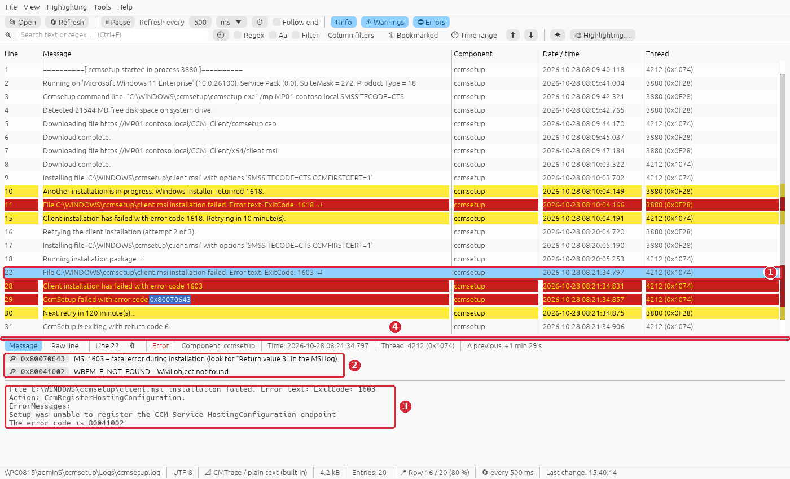
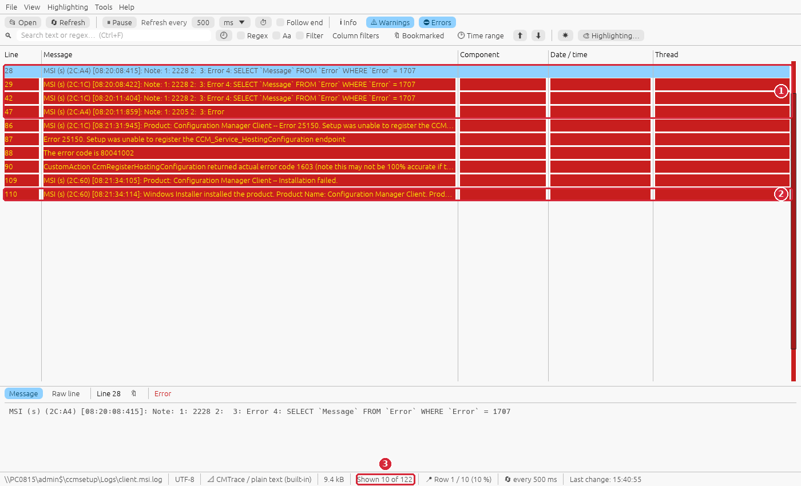
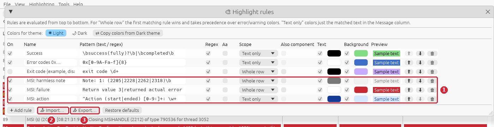
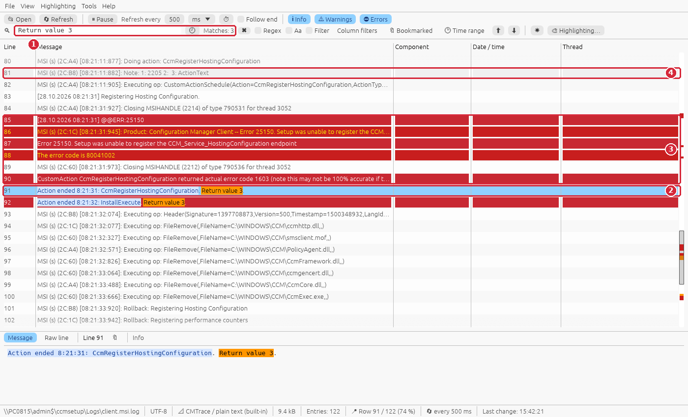
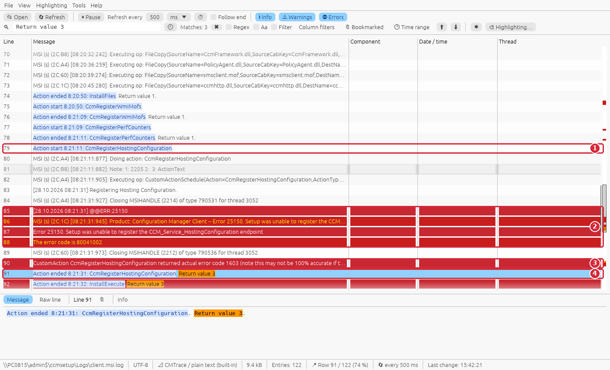
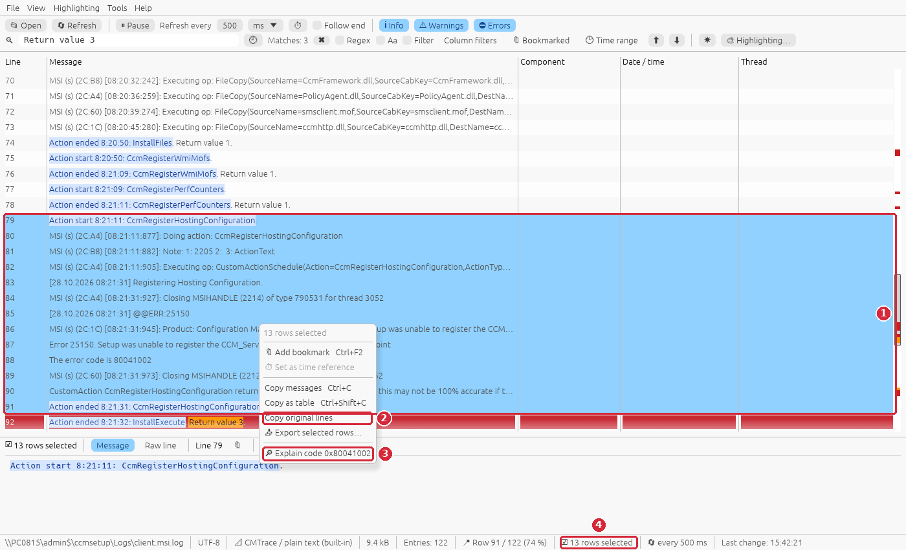
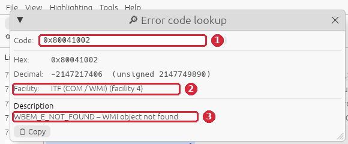

# Guide: the ConfigMgr client installation fails (ccmsetup.log, client.msi.log, MSI 1603)

**Situation:** the ConfigMgr client does not install on a computer – client push reports a
failure, the device shows *No* in the *Client* column, `C:\Windows\CCM` is empty or missing, and
ccmsetup tries again every few hours. You want to know **which part** failed, **why** Windows
Installer returned 1603 and **what to fix** on the computer.

This guide is about the **installation** itself. When ccmsetup ends with return code 0 but the
client does not register, see [A new ConfigMgr client does not register](client-install.md).

**You need:** RusTrace 1.0 or newer and access to `C:\Windows\ccmsetup\Logs` of the computer
(locally, or `\\<computer>\admin$\ccmsetup\Logs` with admin rights).

> The screenshots use invented sample logs. To follow the guide on your own PC, create them with
> `python scripts/gen_guide_logs.py client-msi-1603` (written to
> `testlogs\guides\client-msi-1603\`). The highlight rules of step 5 are in
> [`docs/guides/rules/msi-verbose-log.json`](rules/msi-verbose-log.json).

## The logs involved

| Log | What it tells you |
|---|---|
| `C:\Windows\ccmsetup\Logs\ccmsetup.log` | The bootstrapper (CMTrace format): download of the client files, prerequisites, the start of `client.msi`, its **exit code**, the failed **action** and the error messages, retries and the **return code** of ccmsetup. |
| `C:\Windows\ccmsetup\Logs\client.msi.log` | The verbose Windows Installer log of the client (times only – the date is in the first line; thousands of lines on a real computer): every action, custom action and the rollback. The place where the real cause is written. Read with the built-in definition *Windows Installer log (MSI)*. |

ccmsetup return codes: **0** success, **6** error, **7** reboot required, **8** setup already
running, **9** prerequisite evaluation failure, **10** setup manifest hash validation failure.
The exit codes of client.msi are Windows Installer codes: **1603** fatal error, **1618** another
installation in progress, **1641** / **3010** success with a restart.

Start with **ccmsetup.log** – it tells you whether the MSI log is needed at all.

## Step 1 – ccmsetup.log: what happened, in which attempt

```bat
rustrace.exe \\PC0815\admin$\ccmsetup\Logs\ccmsetup.log
```

Press **Ctrl+Home** (going to the first row pauses *Follow end*, the view stays there):



1. **First attempt (08:10):** `Another installation is in progress. Windows Installer returned
   1618` – client.msi did not even start – and ccmsetup retries in 10 minutes.
2. The retry (*attempt 2 of 3*).
3. **Second attempt (08:21):** client.msi ran for about a minute and a half and failed with
   **1603**; `CcmSetup failed with error code 0x80070643`, next retry in 120 minutes.
4. `CcmSetup is exiting with return code 6` (error).

The yellow / red rows are warnings and errors written by ccmsetup itself (CMTrace type 2 / 3);
the overview strip right of the scroll bar shows where they are.

## Step 2 – The first failure: 1618

Click the row `Client installation has failed with error code 1618`:



1. The selected row.
2. The details pane explains the code: **MSI 1618 – another installation is already in
   progress**. Windows Installer runs only one installation at a time – here something else
   (a Windows update, another software deployment) was installing at 08:10.

ccmsetup handles this itself by retrying. Only if 1618 repeats in every attempt, find out what
keeps the installer busy: the *Application* event log of the computer, source **MsiInstaller**
(events 1040 / 1042 = start / end of a Windows Installer transaction).

## Step 3 – The real failure: 1603 and the failed action

Click the row `File C:\WINDOWS\ccmsetup\client.msi installation failed. Error text: ExitCode:
1603` (↵ = a multi-line message). Drag the border between the table and the details pane up to
see the whole message:



1. The selected row.
2. Both codes in the message are explained: `0x80070643` = **MSI 1603 – fatal error during
   installation** (*look for "Return value 3" in the MSI log*), and `80041002` =
   **WBEM_E_NOT_FOUND – WMI object not found**.
3. The full message: **Action: CcmRegisterHostingConfiguration**, *Setup was unable to register
   the CCM_Service_HostingConfiguration endpoint – The error code is 80041002*. ccmsetup copies
   the failed action and the MSI error messages here, so very often you know the cause without
   opening the MSI log.
4. The border between the table and the details pane – drag it to give the details more room.

A WMI error in a custom action of the client MSI points to a damaged **WMI repository** of the
computer. To be sure – and for every 1603 where ccmsetup.log does not show the action – open the
MSI log.

## Step 4 – client.msi.log: errors only

Open `client.msi.log` (in a second RusTrace window, or add it to the view with **File → Add log
to view…** – its rows are merged by time, the date comes from its first line) and turn **Info**
off. The built-in definition *Windows Installer log (MSI)* (#40) marks only the **real failures**:
`@@ERR:25150`, *Error 25150.*, `returned actual error code 1603`, every `Return value 3`,
*Installation failed* and `error status: 1603` (explained in the details pane as MSI 1603). The
harmless `Note: 1: 2205 2:  3: Error` / `Note: 1: 2228 … Error …` lines (Windows Installer looks
for optional tables the package does not have – they are in almost every MSI log) stay Info.



The screenshot shows an older version, which read the MSI log as plain text and marked lines by
the words *error*, *fail*, *warn*:

1. the harmless `Note: …` lines were "errors",
2. so was the summary line `… Installation success or error status: 1603` (here rightly),
3. **Shown 10 of 122** – and the most important line, `Return value 3`, was **not** among them.

The highlight rules of step 5 are still useful: they gray out the notes and color the action
names, also when the log is opened as plain text (another definition chosen in View → Log format,
an older version).

## Step 5 – Highlight rules for MSI logs

Import the rules from [`docs/guides/rules/msi-verbose-log.json`](rules/msi-verbose-log.json)
(download it from GitHub): **Highlighting → Highlight rules** (Ctrl+H) → **Import…**:



1. Three rules (regular expressions), evaluated from the top – the first matching *Whole row*
   rule wins over the error / warning colors:
   - **MSI: harmless note** – `Note: 1: (2205|2228|2262|2318)` in gray, so the false "errors" fade
     out,
   - **MSI: failure** – `Return value 3`, `returned actual error code`, `Error NNNN.`, `@@ERR:`,
     `Installation failed`, `error status: [1-9]`, `is returning [1-9]` in red,
   - **MSI: action** – the action name in `Action start / ended` lines in blue (text only), so the
     sequence of actions is easy to follow.
2. **Import…** adds the rules from a JSON file (the window may need to be made wider to show all
   columns). Importing the file again does not duplicate them: a rule with the same name and
   pattern is skipped, or updated when the file has other colors; the window says how many rules
   were added / updated / skipped.
3. **Export…** shows the list of your rules with a checkbox each – untick the ones you do not want
   to share and press **Export N rules…** to save the ticked ones as JSON.

The rules apply to every log – they only match MSI text.

## Step 6 – Find the first "Return value 3"

Type `Return value 3` into the search field. Search as you type selects the **first** match:



1. The search – **Matches: 3**.
2. The **first** match is the one that matters: `Action ended 8:21:31:
   CcmRegisterHostingConfiguration. Return value 3.` – the action that failed. The other two
   (`InstallExecute`, `INSTALL`) only pass the failure up.
3. The red rows **just above it** are the cause: `@@ERR:25150`, *Error 25150. Setup was unable to
   register the CCM_Service_HostingConfiguration endpoint*, *The error code is 80041002*, and
   *CustomAction CcmRegisterHostingConfiguration returned actual error code 1603*.
4. A harmless note, grayed out by the rule.

> Press **F3** (or Enter) for the next match. Enter right after typing keeps the first match
> selected – it only confirms the search; the next Enter moves on.

## Step 7 – Read the lines above the failure

Scroll up a little from the first `Return value 3`:



1. `Action start 8:21:11: CcmRegisterHostingConfiguration` – the custom action starts …
2. … and 20 s later fails with **Error 25150** and the WMI error **80041002**.
3. Windows Installer reports the custom action's result: `returned actual error code 1603`.
4. `Return value 3` – the action failed; after it the installation is rolled back
   (`Rollback: …`, `FileRemove`) and the client is not installed.

The time stamps `[08:21:31:945]` of the MSI lines are local times; with the date of the
*Verbose logging started* line the **Δ time** column and merging with ccmsetup.log work for it
(lines without a time, like *Error 25150.*, get the time of the line before them).

## Step 8 – Copy the evidence and check the code

Click the `Action start … CcmRegisterHostingConfiguration` row, **Shift + click** the first
`Return value 3` and right-click the selection:



1. **13 rows selected** – from the start of the custom action to its result.
2. **Copy original lines** – the lines exactly as they are in the log, for a ticket or an e-mail
   (*Copy as table* adds the columns, *Export selected rows…* writes them to a file with more
   context).
3. **Explain code 0x80041002** – RusTrace found a code in the selected rows:



1. The code.
2. **Facility ITF (COM / WMI)** – a WMI error.
3. **WBEM_E_NOT_FOUND – WMI object not found.**

## The fix for this case

The client MSI could not register its WMI endpoint, because WMI on the computer is damaged. On
the computer, in an elevated command prompt:

```bat
winmgmt /verifyrepository
:: if it reports an inconsistent repository:
winmgmt /salvagerepository
```

Then start the client installation again (client push, or `ccmsetup.exe /mp:<MP> SMSSITECODE=<code>`).
If an old client is half-installed, uninstall it first with `C:\Windows\ccmsetup\ccmsetup.exe
/uninstall`. `winmgmt /resetrepository` rebuilds WMI from scratch and is the last resort – it can
remove WMI classes of other software.

## Command line

```bat
:: ccmsetup.log, errors and warnings only
rustrace.exe \\PC0815\admin$\ccmsetup\Logs\ccmsetup.log --warnings

:: client.msi.log, straight at the first failed action
rustrace.exe \\PC0815\admin$\ccmsetup\Logs\client.msi.log --search "Return value 3"

:: every failed action and custom action of an MSI log
rustrace.exe C:\Windows\ccmsetup\Logs\client.msi.log --search "Return value 3|returned actual error code|^Error [0-9]+\." --regex --filter
```

`--search` selects the first match when the log has been read (the same as typing it).

## What to look for

| In the logs | Meaning | Next step |
|---|---|---|
| ccmsetup `Windows Installer returned 1618` | Another installation is running | Nothing if a retry succeeds; else MsiInstaller events 1040 / 1042 in the Application event log |
| ccmsetup `ExitCode: 1603 Action: <name>` | client.msi failed in that action | ErrorMessages in the same row; the MSI log around the first `Return value 3` |
| `Error 25150` with `80041002`, `80041010` | WMI registration of the client failed | `winmgmt /verifyrepository`, `/salvagerepository` |
| `Error 1722` in a custom action | A program run by the setup failed | The program / script named in the error line |
| `Error 1920` | A service could not be started | The service, its account and the System event log |
| `Return value 3` for `CcmCheckPrereqs` / `LaunchConditions` | A launch condition or prerequisite failed | The lines above (OS version, .NET, disk space) |
| ccmsetup `return code 7` | A restart is required | Restart; ccmsetup continues afterwards |
| ccmsetup `return code 9` | A prerequisite failed | ccmsetup.log above the return code |
| ccmsetup `return code 10` | Manifest hash validation failed | Redistribute / refresh the client package on the MP / DP |
| `Note: 1: 2205 …`, `2228`, `2262`, `2318` | Internal MSI notes | Nothing – ignore them |
| `Return value 2` | The user (or a script) cancelled | Who / what cancelled the setup |

## Summary

| Step | What | Shortcut |
|---|---|---|
| 1 | ccmsetup.log: attempts, exit codes, return code | Ctrl+O |
| 2 | 1618 – another installation, ccmsetup retries | – |
| 3 | 1603: the failed action + error messages in the details pane (drag the border) | – |
| 4 | client.msi.log: keyword "errors" are misleading | – |
| 5 | Import the MSI highlight rules | Ctrl+H |
| 6 | Search the first `Return value 3` (F3 for the next one) | Ctrl+F, F3 |
| 7 | Read the lines above it | – |
| 8 | Select, Copy original lines, Explain code | Shift + click, right-click |
