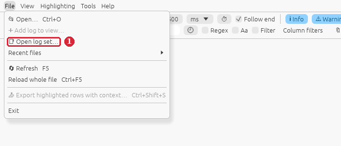
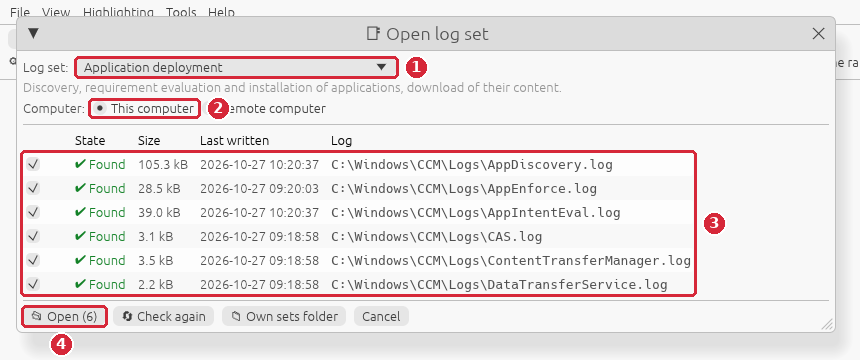
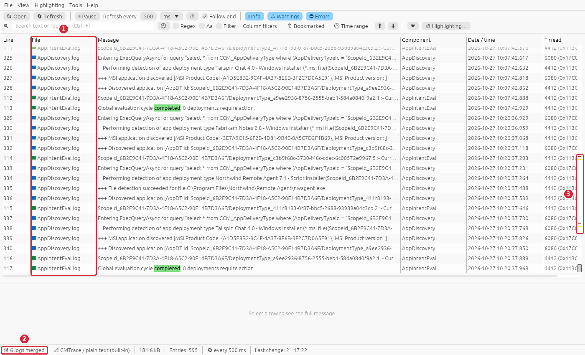
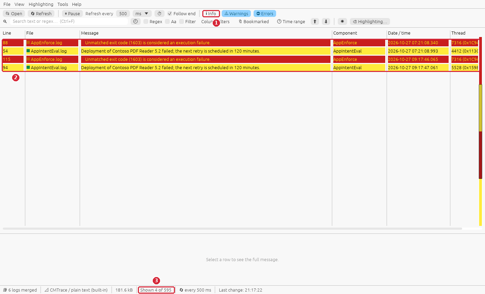
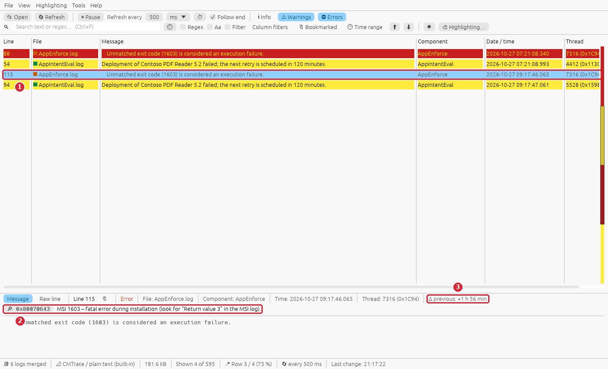
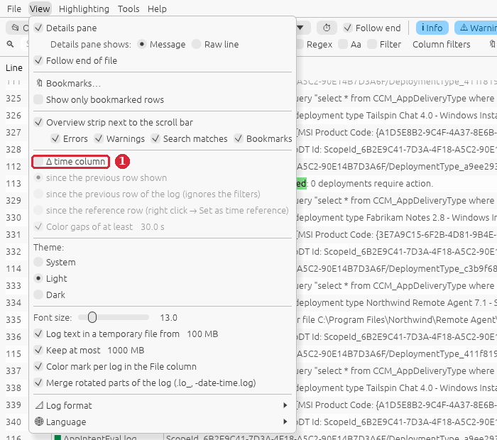
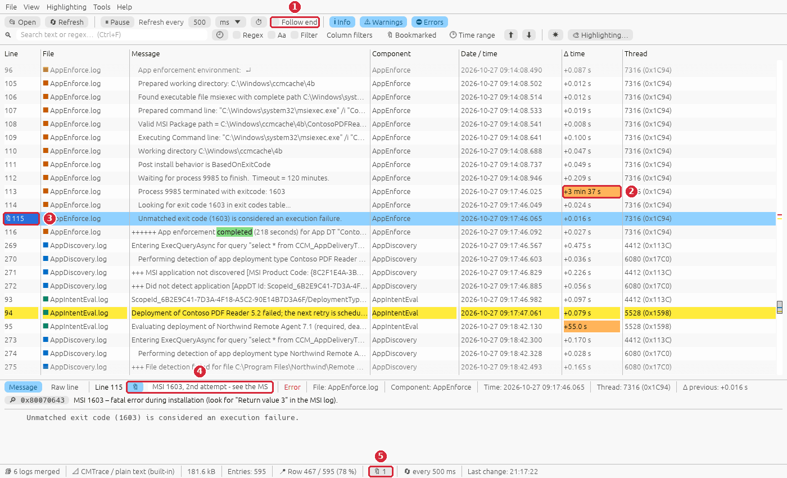
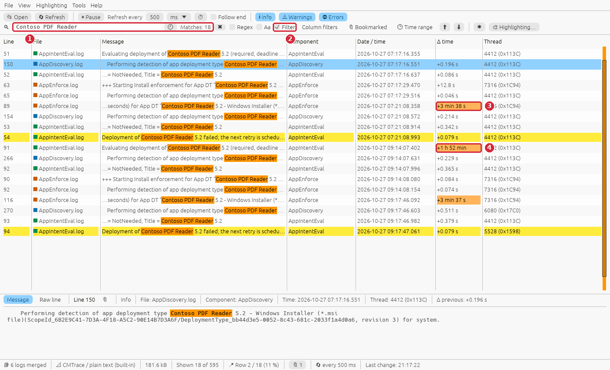
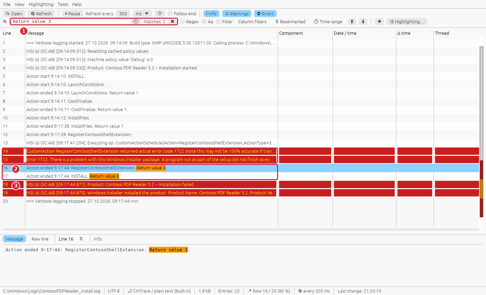
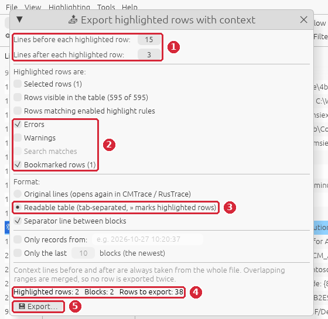

# Guide: an application deployment failed

**Situation:** a required application from ConfigMgr does not install on a client. Software
Center shows *Failed* (often with `0x80070643`), or the user says "it keeps installing and nothing
happens". You want to know **why** it failed, **how long** it took and **what to send** to the
packager or the vendor.

**You need:** RusTrace 1.0 or newer and read access to the client's logs. On the client itself you
need nothing else. For a remote client you need admin rights on it (the logs are read over
`\\<computer>\admin$`).

> The screenshots use invented sample logs. To follow the guide step by step on your own PC,
> create the same logs with `python scripts/gen_guide_logs.py failed-app-install` (they are written to
> `testlogs\guides\failed-app-install\`) and open them as in [step 1, option B](#option-b-open-the-files).

## The logs involved

| Log | What it tells you |
|---|---|
| `AppIntentEval.log` | Is the deployment required and applicable? Current state of the app (`NotInstalled`, `Installed`, `Error`) and when the next retry is planned. |
| `AppDiscovery.log` | The **detection method** – is the app found as installed, before and after the installation? |
| `AppEnforce.log` | The **installation itself**: command line, working folder, process ID, waiting time, **exit code** and how ConfigMgr interprets it. |
| `CAS.log`, `ContentTransferManager.log`, `DataTransferService.log` | Download of the content from the distribution point into `C:\Windows\ccmcache`. |
| MSI verbose log (e.g. `C:\Windows\Logs\<app>_install.log`) | Why Windows Installer failed – only exists if the command line has `/l*v <file>`. |

All of them except the MSI log are in `C:\Windows\CCM\Logs`. RusTrace opens them **together in one
table sorted by time**, so you see the whole deployment as one story instead of switching between
six windows.

## Step 1 – Open the logs of the deployment

### Option A: log set (recommended)

1. **File → Open log set…**

   

2. In the window:
   1. **Log set:** *Application deployment*,
   2. **Computer:** *This computer* – or *Remote computer* and the name / IP of the client
      (e.g. `PC0815`); RusTrace then reads `\\PC0815\admin$\CCM\Logs\…`,
   3. check the list: ✔ *Found* with the size and the last write time of every log. A log that
      was written last a long time ago is probably not the one you need,
   4. press **Open**.

   

### Option B: open the files

Select the logs in **File → Open…** with Ctrl + click (or drop them onto the window together), or
use the [command line](#command-line). Several files are always shown as one view sorted by time.

## Step 2 – Find your way in the merged view



1. The **File** column shows which log every row comes from; every log has its own color mark.
2. The status bar shows **📚 6 logs merged** – its tooltip lists every log with its format and
   number of rows.
3. The **overview strip** right of the scroll bar marks where errors (red), warnings (yellow),
   search matches and bookmarks are in the whole view. Click it to scroll there; the tooltip shows
   the row and its time.

## Step 3 – Show only what went wrong



1. Turn **Info** off in the toolbar – only warnings and errors stay.
2. You see the failure immediately: `Unmatched exit code (1603) is considered an execution
   failure.` in `AppEnforce.log`, followed by `Deployment … failed; the next retry is scheduled
   in 120 minutes.` in `AppIntentEval.log`. Here it happened **twice** (07:21 and 09:17) – the
   automatic retry failed the same way, so it is not a one-off problem.
3. The status bar shows how many rows are shown out of all (`Shown 4 of 595`).

## Step 4 – Let RusTrace explain the error

Click the newest error row.



1. The selected row.
2. The details pane **explains the code** found in the message: exit code 1603 =
   `0x80070643` – *MSI 1603 – fatal error during installation (look for "Return value 3" in the
   MSI log)*. Codes can also be looked up manually with **Tools → Error code lookup** (Ctrl+E).
3. **Δ previous** – the time since the previous row shown. With only errors shown it is the time
   between the two failures (+1 h 56 min ≈ the 120-minute retry).

## Step 5 – Look at what happened just before the error

1. Turn **Info** back on and **untick "Follow end"** in the toolbar, so the table stays where you
   are and does not jump to the newest rows while the logs are refreshed.
2. Turn on the **Δ time column**: **View → Δ time column** (or right-click any column header).

   

3. Press **Ctrl+F2** on the selected error row to **bookmark** it and type a note into the field
   next to 🔖 in the details pane. **F2 / Shift+F2** jump between bookmarks from anywhere in the
   log; **View → Bookmarks…** lists them.



1. *Follow end* is off.
2. **Δ time `+3 min 37 s`** – the installer process ran for 3½ minutes before it ended with
   `exitcode: 1603`. Gaps of 30 s and more are colored, so long waits stand out. A long run that
   ends with an error usually means the installer did real work and failed late (a custom
   action, a service, a reboot-pending check) – not a wrong command line or missing file, which
   fail within seconds.
3. The bookmarked row (🔖 in the line number).
4. The note of the bookmark.
5. **🔖 1** in the status bar – click it to open the list of bookmarks.

Read the AppEnforce rows above the error from the bottom up: `Waiting for process 9985 to
finish`, `Executing Command line: "…msiexec.exe" /i "ContosoPDFReader.msi" /qn /l*v
C:\Windows\Logs\ContosoPDFReader_install.log`, `Prepared working directory: C:\Windows\ccmcache\4b`.
The command line tells you **where the MSI log is** – that is the next step. The multi-line
`App enforcement environment` row (↵) shows the full environment in the details pane.

## Step 6 – Follow only this application across all logs



1. Type the application name (`Contoso PDF Reader`) into the search field (Ctrl+F) – the number of
   matches appears next to it.
2. Tick **Filter** (Ctrl+L) – only the rows of this application stay, from all six logs.
3. With the Δ column you read the whole timeline of the deployment: evaluation → detection
   (*not discovered*) → enforcement started → **3 min 38 s** later failed …
4. … → **1 h 52 min** later the retry → again 3 min 37 s → failed.

Useful search texts for application deployments (tick **Regex** for the last two):

| Search | Finds |
|---|---|
| the application name | evaluation, detection and enforcement of this app |
| `ScopeId_…/DeploymentType_…` (copy from a row) | the same deployment type, also in rows without the name |
| `exitcode\|exit code` | every installer result |
| `not discovered\|Did not detect` | the detection method did not find the app |

Clear the search with ✖ when you are done.

## Step 7 – Look into the MSI log

The details pane of step 4 said *look for "Return value 3" in the MSI log*, and step 5 gave its
path. Open it in a second RusTrace window (start `rustrace.exe` again, or use the
[command line](#command-line)) and search for `Return value 3`:



1. The search finds the action that failed (`Return value 3`).
2. The rows **just above** the first `Return value 3` are the real cause. Here the custom action
   `RegisterContosoShellExtension` (`regsvr32.exe /s ContosoShellExt.dll`) failed with
   `Error 1722` – a problem of the package, not of ConfigMgr.
3. `Installation failed` and `Installation success or error status: 1603` confirm it.

The MSI log has times but no dates, so it cannot be sorted by time together with the ConfigMgr
logs – that is why it gets its own window.

## Step 8 – Export the evidence for a ticket

Press **Ctrl+P** to pause the automatic refresh (the logs then do not change while you export),
then **File → Export highlighted rows with context…** (Ctrl+Shift+S):



1. **Lines before / after each highlighted row** – e.g. 15 before (the whole enforcement) and 3
   after.
2. **Highlighted rows are:** *Errors* and *Bookmarked rows*; untick *Rows matching enabled
   highlight rules* and *Warnings* to keep the export short.
3. **Format:** *Readable table* – tab-separated with time, severity, component and message, good
   for an e-mail, a ticket or Excel. *Original lines* gives the raw CMTrace lines that open again
   in CMTrace / RusTrace – better when you send it to someone who analyses logs.
4. The preview: **2 highlighted rows, 2 blocks, 38 rows to export** – overlapping ranges are
   merged, so no row is exported twice.
5. **Export…** and choose the file. Press **Ctrl+P** again to resume the refresh.

To send just a few rows, select them (Shift + click) and press **Ctrl+Shift+C** – they are copied
as a table with a header line.

## Command line

The same investigation can be started directly, e.g. from a script or a shortcut:

```bat
:: All logs of the deployment, merged by time, only the rows of the application
rustrace.exe C:\Windows\CCM\Logs\AppIntentEval.log C:\Windows\CCM\Logs\AppDiscovery.log C:\Windows\CCM\Logs\AppEnforce.log --search "Contoso PDF Reader" --filter

:: Only errors of the enforcement from today 7:00 on, without following the end
rustrace.exe C:\Windows\CCM\Logs\AppEnforce.log --errors --from "2026-10-27 07:00" --no-follow

:: Every installer result (regular expression)
rustrace.exe C:\Windows\CCM\Logs\AppEnforce.log --search "exit ?code" --regex --filter

:: The MSI log, straight at the failed action
rustrace.exe C:\Windows\Logs\ContosoPDFReader_install.log --search "Return value 3"

:: The logs of a remote client over its admin share
rustrace.exe \\PC0815\admin$\CCM\Logs\AppEnforce.log \\PC0815\admin$\CCM\Logs\AppDiscovery.log
```

`--from` / `--to` accept ISO dates (`2026-10-27 07:00`) or the date format of the UI language;
`rustrace.exe --help` lists every option. More in the README, section *Command line*.

## What to look for

| In the logs | Meaning | Next step |
|---|---|---|
| `exitcode: 1603`, `0x80070643` | MSI 1603 – fatal error during installation | MSI log: rows above the first `Return value 3` |
| `exitcode: 1618`, `0x80070652` | Another installation is already in progress | ConfigMgr retries automatically ("fast retry"); find what else was installing at that time (search `Executing Command line`) |
| `exitcode: 3010` / `1641` | Success, a restart is needed / was started | Not an error – check the deployment's restart settings |
| `Unmatched exit code (N)` | The exit code is not in the deployment type's *Return codes* list, so it counts as a failure | If the code really means success (some setup.exe), add it to the return codes |
| `0x87D00324` | Installed, but **not detected** afterwards | AppDiscovery: the detection method (product code, file path, version) does not match what the installer installs |
| `0x87D00607` | Content not found | CAS / ContentTransferManager: no distribution point with the content for the client's boundary group |
| `0x87D01106` | The executable or the command line is not valid | AppEnforce: `Prepared command line` – wrong file name, missing quotes, file not in the content |
| `0x87D00314` | CI version info timed out | Policy or content not available yet – check policy retrieval and content distribution |
| long Δ before `terminated with exitcode` | the installer ran a long time | it failed late: MSI log, custom actions, services, pending reboot |
| short Δ (seconds) before the error | the installer did not really start | command line, missing file, wrong context (system vs. user) |

Any code can be checked with **Tools → Error code lookup** (Ctrl+E): hex (`0x80070643`), negative
decimal (`-2147023293`) or Win32 / MSI number (`1603`).

## Summary

| Step | What | Shortcut |
|---|---|---|
| 1 | File → Open log set… → *Application deployment* | – |
| 3 | Info off – only warnings and errors | – |
| 4 | Click the error – the details pane explains the code | Ctrl+E for any code |
| 5 | Follow end off, View → Δ time column, bookmark + note | Ctrl+F2, F2 |
| 6 | Search the app name + Filter | Ctrl+F, Ctrl+L |
| 7 | MSI log, search `Return value 3` | Ctrl+O |
| 8 | Pause, export errors + bookmarks with context | Ctrl+P, Ctrl+Shift+S |
