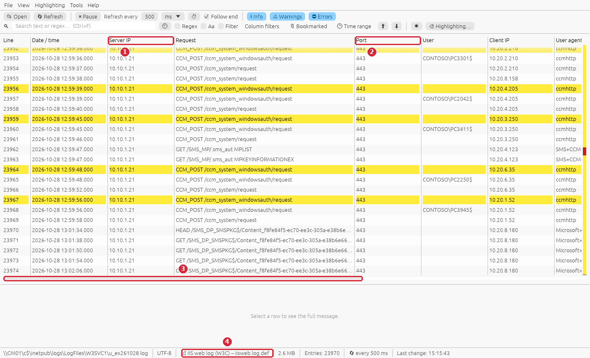
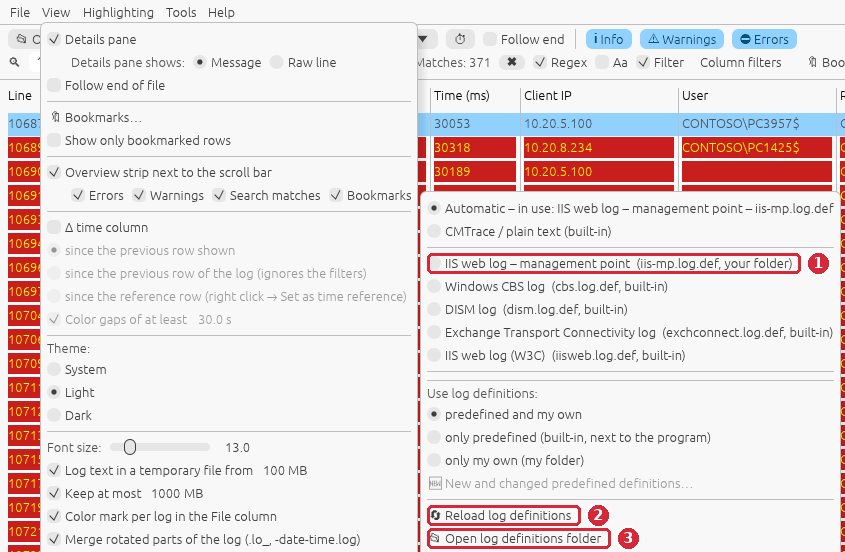
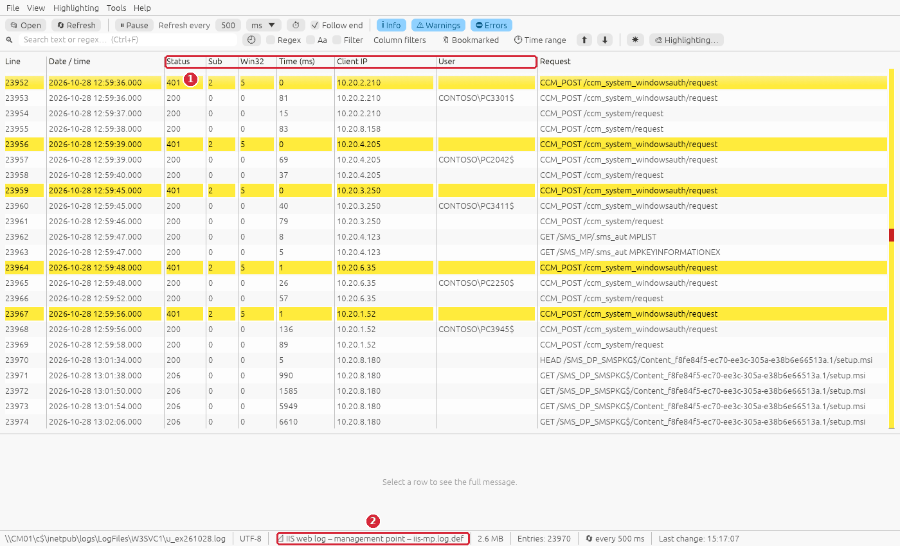
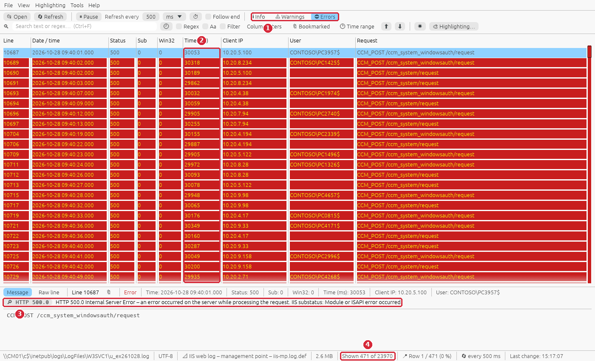
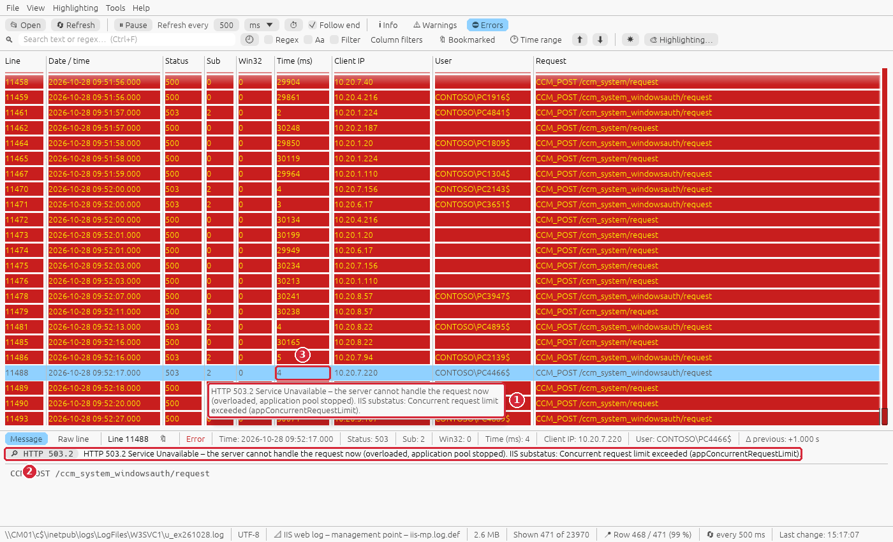
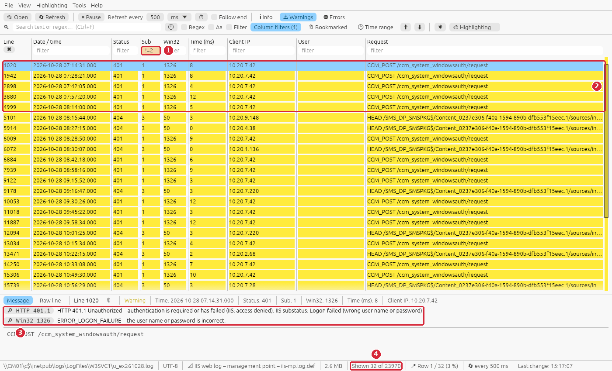
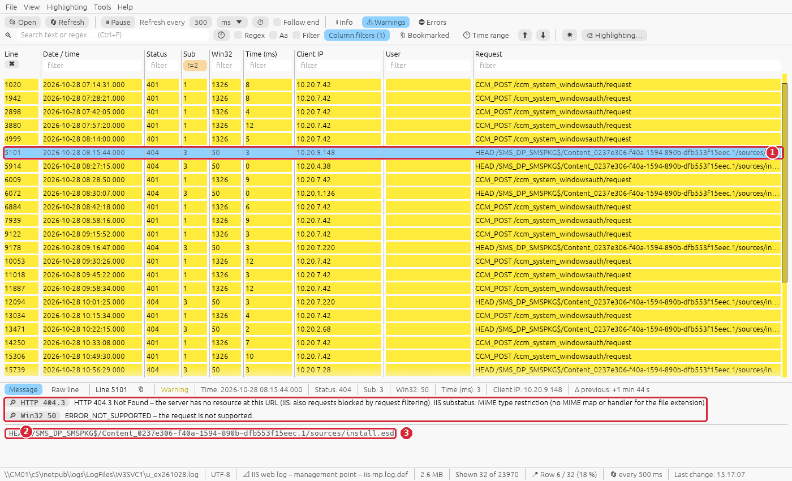
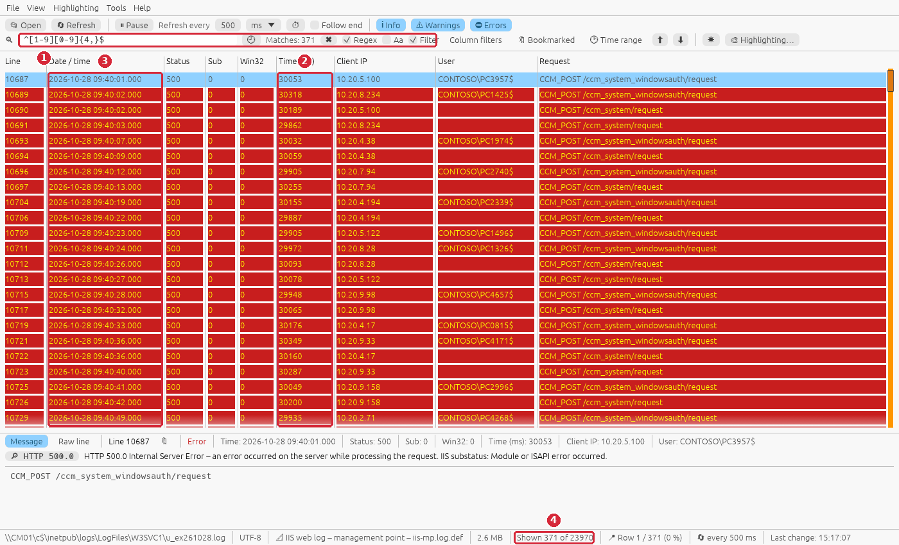

# Guide: the management point / distribution point is not healthy (IIS log)

**Situation:** many clients report errors at the same time – policies are not downloaded,
software stays at *Downloading*, the console shows management point errors – or one single client
cannot talk to the site. The management point (MP) and the distribution point (DP) are web
applications in IIS, so the **IIS log of the site server** shows every request of every client
with its result. You want to know **when** it failed, **which** requests, **which** clients and
**why**.

**You need:** RusTrace 1.0 or newer and read access to the IIS logs of the server (locally, or
`\\<server>\c$\inetpub\logs\LogFiles\W3SVC1` with admin rights).

> The screenshots use an invented sample log (24 000 requests of 300 clients). To follow the
> guide on your own PC, create it with `python scripts/gen_guide_logs.py iis-management-point`
> (written to `testlogs\guides\iis-management-point\`) and open it.

## The log

- IIS writes one file per day per web site: `C:\inetpub\logs\LogFiles\W3SVC<site id>\u_exYYMMDD.log`
  (the *Default Web Site* is `W3SVC1`; the MP and the DP usually live there).
- Format **W3C**: a `#Fields:` header names the columns. RusTrace recognizes it by the header and
  uses the built-in definition *IIS web log (W3C)*: errors = HTTP 5xx, warnings = 4xx.
- **Times are UTC** in the file; RusTrace shows them in local time.

What the ConfigMgr requests look like:

| Request | What it is |
|---|---|
| `CCM_POST /ccm_system/request` | Policy and other requests of clients (anonymous) |
| `CCM_POST /ccm_system_windowsauth/request` | The same with Windows authentication – first answered `401.2` (normal handshake), then `200` |
| `GET /SMS_MP/.sms_aut MPLIST`, `MPKEYINFORMATIONEX` | Management point list, site signing key |
| `HEAD` / `GET /SMS_DP_SMSPKG$/Content_…/<file>` (agent *Microsoft BITS*) | Content download from the DP; `206` = partial content (normal for BITS) |

## Step 1 – Open the log and check the columns

```bat
rustrace.exe \\CM01\c$\inetpub\logs\LogFiles\W3SVC1\u_ex261028.log
```



The built-in definition shows the columns that matter first: date / time, **Status**,
**Substatus**, **Win32 status**, **Time (ms)**, Client IP, User and the request; the rest of the
`#Fields:` header (Server IP, Port, User agent, Referer, host, bytes …) follows on the right
(#41). The screenshot was taken with an older version, which showed the columns in the order of
the `#Fields:` header:

1. and 2. Server IP, Port and User agent took the space …
3. … and the status columns were off to the right (scroll horizontally with the bar below the
   table or Shift + mouse wheel).
4. The status bar shows the definition in use: *IIS web log (W3C) – iisweb.log.def*.

## Step 2 (optional) – Your own column order (a log definition, no programming)

The built-in definition already shows the status columns first, so this step is only needed when
you want another order, shorter headers or fewer columns. A log definition is a small text file.
Make a copy for the management point with exactly the columns you need: **View → Log format → Open log definitions folder** (your folder is
`%APPDATA%\RusTrace\logdef`) and save this as `iis-mp.log.def`:

```
# IIS log of the management point – columns for ConfigMgr troubleshooting
name = IIS web log – management point
format = w3c
files = u_ex*.log
detect = ^#(Software: Microsoft Internet Information Services|Fields: date time )
role.datetime = date time
role.message = cs-method cs-uri-stem cs-uri-query
role.severity = sc-status
datetime.format = %Y-%m-%d %H:%M:%S
timezone = utc
severity.error = ^5\d\d$
severity.warning = ^4\d\d$
http_status = sc-status
http_substatus = sc-substatus
win32_status = sc-win32-status
columns = datetime sc-status sc-substatus sc-win32-status time-taken c-ip cs-username message
title.message = Request
title.sc-status = Status
title.sc-substatus = Sub
title.sc-win32-status = Win32
title.time-taken = Time (ms)
title.c-ip = Client IP
title.cs-username = User
```

Then **View → Log format → Reload log definitions** and **Ctrl+F5** (read the file again):



1. Your definition (*your folder*) – your own definitions win over the built-in ones for the
   same files, and *Automatic* now uses it.
2. **Reload log definitions** after every change of the file – no restart needed.
3. **Open log definitions folder**.



1. **Status, Sub, Win32, Time (ms), Client IP, User**, then the request. The columns not listed
   in `columns` (server IP, port, user agent) are not shown – add `*` at the end of `columns` to
   keep them after the listed ones (the built-in definition does that). Column widths can be changed by
   dragging the header borders.
2. The status bar: *IIS web log – management point – iis-mp.log.def*.

`http_status`, `http_substatus` and `win32_status` tell RusTrace which columns to explain
(steps 3 – 5).

## Step 3 – When did it fail? (5xx errors)

Turn **Info** and **Warnings** off and press **Ctrl+Home**:



1. Only **Errors** (= HTTP 5xx) are shown.
2. **Time (ms) ≈ 30 000** – every failing request waited 30 seconds and then failed. That is a
   timeout behind IIS – typically the management point cannot get an answer from its
   **database** (SQL Server).
3. The details pane explains the status: **HTTP 500.0** – *Internal Server Error … IIS substatus:
   Module or ISAPI error occurred*.
4. **Shown 471 of 23970** – errors only between 09:40 and 09:52 (local time).

Press **End** to see the end of the block:



1. Hover a status or substatus cell – the **tooltip** explains it: **503.2** – *Concurrent request
   limit exceeded (appConcurrentRequestLimit)*.
2. The same explanation in the details pane of the selected row.
3. **Time (ms) 4** – 503 is answered immediately: so many requests were waiting for the 30-second
   timeout that IIS rejected new ones.

So: from 09:40 to 09:52 the management point could not reach its database. Check the **SQL
Server / site database** at that time (and the MP's `MP_*.log` files in
`<ConfigMgr>\SMS_CCM\Logs` on the server) – IIS itself was fine.

## Step 4 – Warnings: what is normal and what is not

Turn **Warnings** on (Errors off). Almost all of them are **401.2** – the normal first step of
Windows authentication: the client is asked to authenticate and the next request succeeds.
Hide them with a column filter:



1. **Column filters** in the toolbar → type `!=2` into the **Sub** column (`!` = not, `=` =
   exactly): every row whose substatus is exactly 2 is hidden.
2. What remains is interesting: one client, **10.20.7.42**, gets **401.1** with Win32 status
   **1326** every 15 minutes, all morning – its authentication fails.
3. The details pane: **401.1** *Logon failed (wrong user name or password)*, Win32 **1326**
   *the user name or password is incorrect*. For a computer this means a broken **computer
   account / secure channel** – on that client run `Test-ComputerSecureChannel -Repair` (or
   rejoin it to the domain).
4. **Shown 32 of 23970**.

The column filter syntax: `text` contains, `=text` exactly, `a|b` any of them, `!` at the start =
none of them – e.g. `=500|=503` in **Status**, `10.20.7.42` in **Client IP**.

## Step 5 – A file that cannot be downloaded (404.3)

Click one of the **404** rows of step 4:



1. `HEAD /SMS_DP_SMSPKG$/Content_…/sources/install.esd` – a client tries to download a Windows
   image file from the distribution point.
2. **404.3** – *MIME type restriction (no MIME map or handler for the file extension)*: IIS does
   not serve files with an extension it does not know.
3. The request – the file name and the content ID tell you which package.

Fix: add the extension (`.esd`, `.wim`, `.cab`, …) as a MIME type (`application/octet-stream`) on
the DP's web site (IIS Manager → the site → *MIME Types*).

## Step 6 – Slow requests

The search box also searches the extra columns. A regular expression finds every request that
took 10 seconds or more (a number of five or more digits in a column):



1. Search `^[1-9][0-9]{4,}$` with **Regex** and **Filter** on.
2. **Time (ms)** – all of them are the ~30-second timeouts of step 3.
3. The **Date / time** column: 09:40 – 09:52, nothing else in the whole day.
4. **Shown 371 of 23970**.

Other useful searches (Regex on):

| Search | Finds |
|---|---|
| `10.20.7.42` (Client IP column filter) | everything of one client |
| `ccm_system` | policy requests only |
| `SMS_DP_SMSPKG` | content downloads only |
| `MPLIST\|MPKEYINFORMATION` | MP list and key requests |

To see the time of the problem in the client's own logs (PolicyAgent.log, DataTransferService.log),
remember the IIS time is shown in **local time** here, like the client logs.

## Command line

```bat
:: Only errors of the day
rustrace.exe \\CM01\c$\inetpub\logs\LogFiles\W3SVC1\u_ex261028.log --errors

:: Everything of one client
rustrace.exe \\CM01\c$\inetpub\logs\LogFiles\W3SVC1\u_ex261028.log --search 10.20.7.42 --filter

:: Requests that took 10 s or more, between 9:00 and 11:00 local time
rustrace.exe \\CM01\c$\inetpub\logs\LogFiles\W3SVC1\u_ex261028.log --search "^[1-9][0-9]{4,}$" --regex --filter --from "2026-10-28 09:00" --to "2026-10-28 11:00"
```

## What to look for

| Status | Meaning (for the MP / DP) | Next step |
|---|---|---|
| `401.2` | Normal Windows authentication handshake | Nothing (hide with Sub = `!=2`) |
| `401.1` + Win32 `1326` | Logon failed – broken computer account of that client | `Test-ComputerSecureChannel -Repair` / rejoin the domain |
| `403.4`, `403.7`, `403.16` | HTTPS / client certificate required / untrusted | PKI: client certificate, the site's HTTPS settings |
| `404.3` | No MIME type for the extension | MIME type on the DP web site |
| `404.7`, `404.11`, `404.15` | Request filtering (extension, double escaping, query too long) | Request filtering of the site (`web.config` / IIS Manager) |
| `500.0` with Time ≈ 30 000 | MP / DP waits for a back end (database) and times out | SQL Server, site database, MP logs on the server |
| `500.19` | Configuration data is invalid | `web.config` / applicationHost.config of the MP / DP |
| `503.0` | Application pool stopped | `CCM Server Framework Pool` / `SMS Distribution Points Pool` in IIS – start it, check why it stopped (rapid-fail protection) |
| `503.2` | Concurrent request limit exceeded | Usually a consequence of slow requests (fix those); otherwise the IIS / pool limits |
| Win32 `64` on a download | The client closed the connection | Usually harmless (BITS resumes); many of them: network or a proxy |

## Summary

| Step | What | Shortcut |
|---|---|---|
| 1 | Open `u_exYYMMDD.log` – built-in IIS definition | Ctrl+O |
| 2 | Optional: own definition with your own columns, reload | View → Log format |
| 3 | Errors only – 500 after 30 s, then 503.2 | – |
| 4 | Warnings, column filter Sub = `!=2` | Column filters |
| 5 | 404.3 – MIME type | – |
| 6 | Regex search of slow requests + Filter | Ctrl+F, Ctrl+L |
