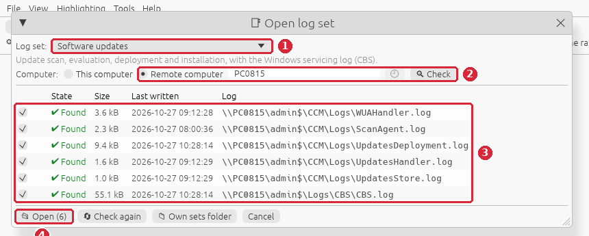
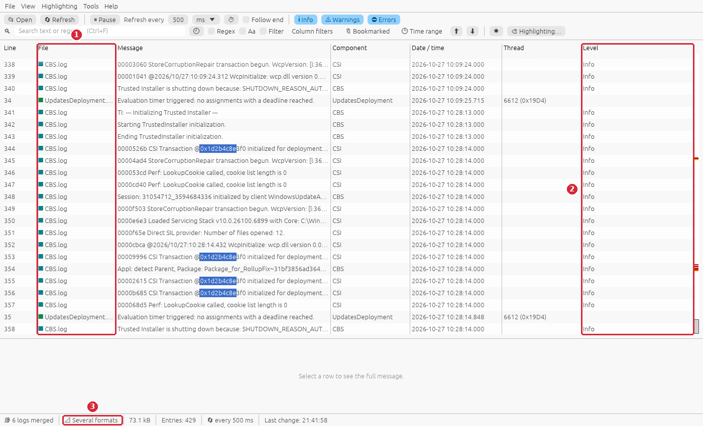
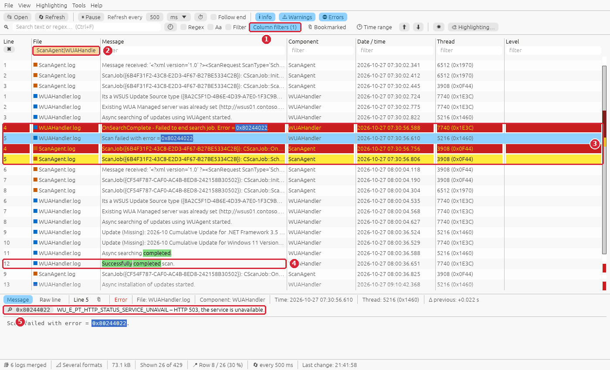
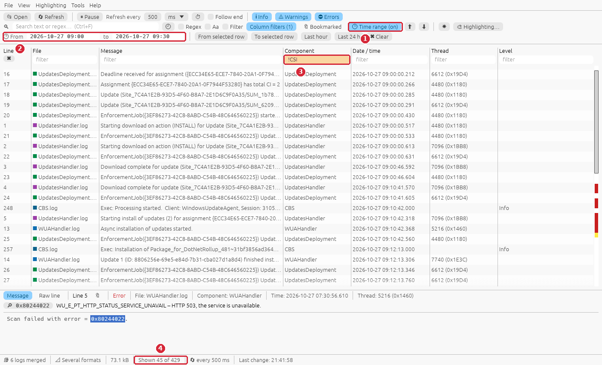
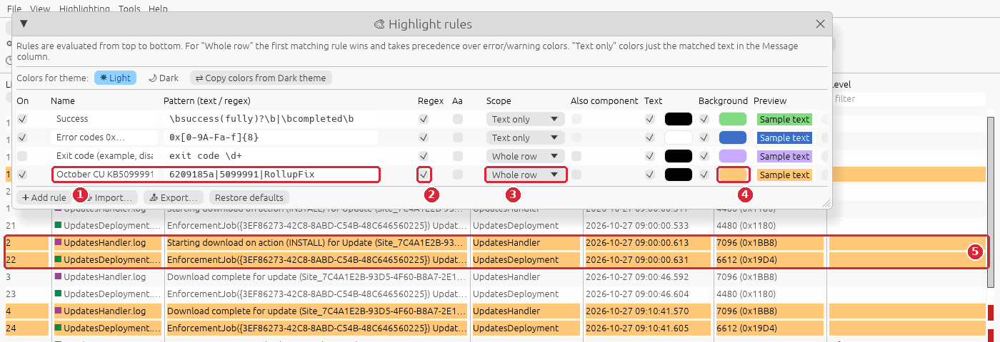
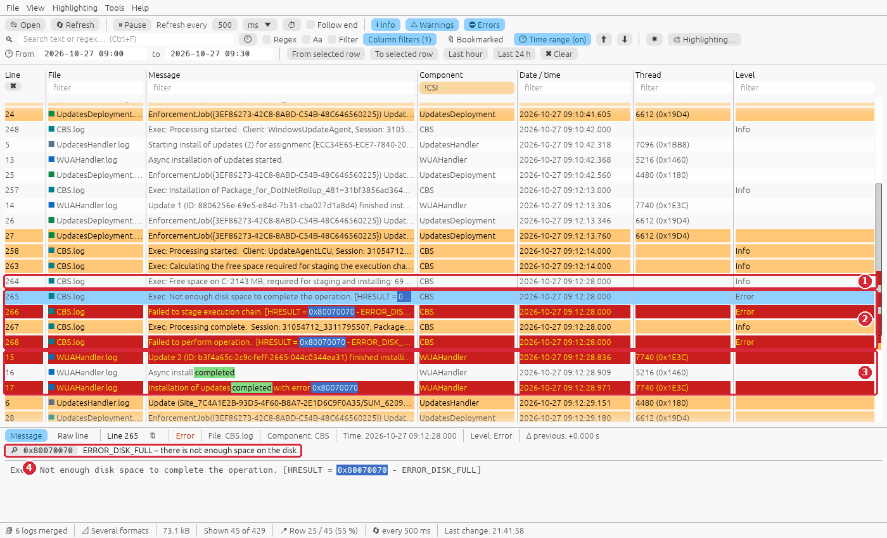
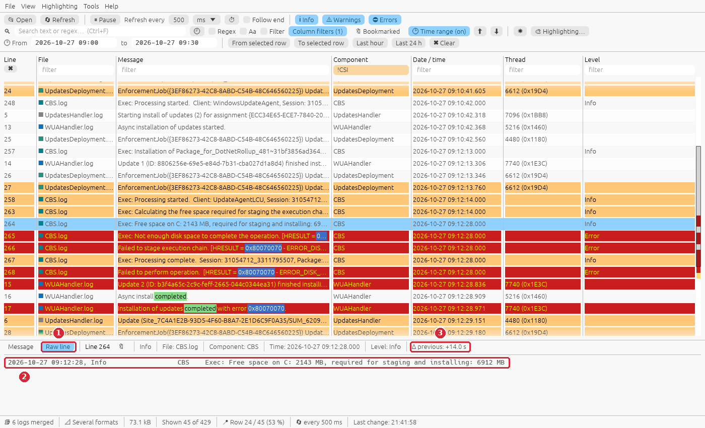
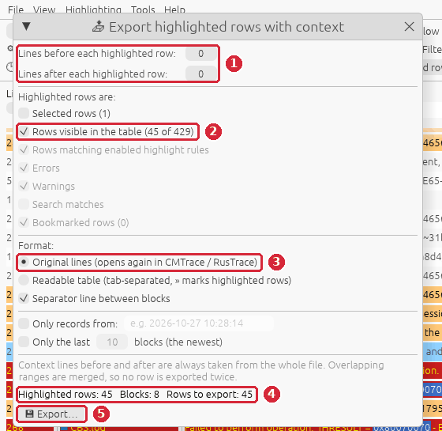

# Guide: software updates do not install

**Situation:** a client does not get the monthly updates from ConfigMgr. Software Center shows
the cumulative update as *Failed* (here `0x80070070`), or the compliance report says the client
is still missing updates after the deadline. You want to know whether the **scan** works, what
happened at the **deadline** and **why** the installation failed – on a remote client, without
signing in to it.

**You need:** RusTrace 1.0 or newer and admin rights on the client (the logs are read over
`\\<computer>\admin$`), or the client itself.

> The screenshots use invented sample logs. To follow the guide on your own PC, create them with
> `python scripts/gen_guide_logs.py software-updates` (written to
> `testlogs\guides\software-updates\`) and open them with **File → Open…** (select all six files).

## The logs involved

| Log | What it tells you |
|---|---|
| `ScanAgent.log` | Scan requests and their result; scheduled retries after a failed scan. |
| `WUAHandler.log` | The Windows Update Agent: which update source (WSUS / software update point) is used, the scan itself, the installation of every update and its result code. |
| `UpdatesDeployment.log` | Deployments (assignments) and deadlines, which updates belong to them, the progress of every update (`ciStateDownloading` … `ciStateError`). |
| `UpdatesHandler.log` | Download and installation jobs. |
| `UpdatesStore.log` | The status of every update on the client (`Missing`, `Installed`). |
| `C:\Windows\Logs\CBS\CBS.log` | Windows servicing (Component Based Servicing): what really happened while the update was installed, with an `[HRESULT = …]` on errors. |

The first five are in `C:\Windows\CCM\Logs` and use the CMTrace format; `CBS.log` has its own
format. RusTrace opens all six **in one table sorted by time** – the different formats are
merged, so a ConfigMgr error and the CBS error behind it are next to each other.

## Step 1 – Open the logs of the remote client

**File → Open log set…**



1. **Log set:** *Software updates*.
2. **Remote computer**, type the name or IP of the client (`PC0815`) and press **Check** (or
   Enter). The 🕘 button next to the name lists the computers you used before.
3. RusTrace checks the logs over `\\PC0815\admin$` in the background: ✔ *Found*, size, last write
   time. An offline computer, missing rights or a missing share are reported within seconds and the
   window does not freeze.
4. **Open**.

## Step 2 – The merged view of different formats



1. The **File** column – every log has its own color mark.
2. **Level** – the extra column of `CBS.log` (*Info*, *Error*, …). Columns that exist only in some
   logs stay empty for the others.
3. **Several formats** in the status bar – CMTrace and the CBS log definition are used together.

`CBS.log` is big and noisy; the next steps filter it.

## Step 3 – Did the scan work?

Without a successful scan the client does not know which updates it needs. Show only the scan
logs:



1. **Column filters** in the toolbar – a filter field appears under every column header.
2. In the **File** column type `ScanAgent|WUAHandler` (`|` = any of them). The button shows how
   many column filters are active.
3. The scan at **07:30 failed**: `Scan failed with error = 0x80244022`, and ScanAgent scheduled a
   retry in 30 minutes.
4. The retry at **08:00 succeeded**: `Successfully completed scan`, and the two missing updates
   are listed just above it (`Update (Missing): …`).
5. The details pane of the selected error explains the code: `WU_E_PT_HTTP_STATUS_SERVICE_UNAVAIL`
   – the WSUS server answered **HTTP 503**. One failed scan that is followed by a successful
   retry is not the cause of the problem, but if **every** scan fails, look at the WSUS server
   (typically the `WsusPool` application pool in IIS is stopped).

Clear the column filters with **✖** in the Line column header.

## Step 4 – Look only at the deadline

The deployment has a deadline at 09:00. Limit the view to that time and hide the noise:



1. **🕑 Time range** in the toolbar opens the *From – to* row.
2. Type `2026-10-27 09:00` and `2026-10-27 09:30` (ISO, or the date format of your UI language).
   *To* includes the whole minute; *From selected row* / *To selected row* / *Last hour* take the
   time from the log. The button shows **(on)** while a range is active.
3. With **Column filters** on, type `!CSI` into the **Component** column – `!` hides every row
   whose component contains `CSI` (the low-level servicing rows of `CBS.log`).
4. The status bar: **Shown 45 of 429** rows.

Now you can read the deployment from the top: `Deadline received for assignment …`, the two
updates added to it, their download (`ciStateDownloading` → `Download complete`) and the start
of the installation.

## Step 5 – Color all rows of the failed update

The updates appear in the logs under different names: the title and the KB number, an update ID
`Site_…/SUM_<guid>` and in `CBS.log` a package name (`Package_for_RollupFix…` for a cumulative
update). One highlight rule can color all of them.

1. Find the row `Update (Site_…/SUM_6209185a-…) Name (2026-10 Cumulative Update … (KB5099991))
   ArticleID (5099991) added to the targeted list …` – it connects the ID with the KB number.
2. **Highlighting → Highlight rules** (Ctrl+H) → **Add rule**:



1. **Name** and **Pattern**: `6209185a|5099991|RollupFix` – the beginning of the update ID, the KB
   number and the CBS package name.
2. **Regex** on (because of the `|`).
3. **Scope:** *Whole row*.
4. **Background** color (a new rule gets orange; click the color to change it).
5. The table colors the matching rows immediately – here the download and progress rows of the
   cumulative update, while the .NET update stays uncolored.

Rules are evaluated from the top, the first matching *Whole row* rule wins, and the rules are
saved with the settings. **Export…** in the same window saves them as a JSON file for colleagues.

## Step 6 – Find the cause of the failure

Scroll down to the installation (or turn off **Info** to see only warnings and errors) and click
the first `CBS.log` error:



1. **The cause, one row above the error:** `Exec: Free space on C: 2143 MB, required for staging and
   installing: 6912 MB` – a row with level *Info*, so it is only visible with Info rows shown.
2. `CBS.log` errors with `[HRESULT = 0x80070070 - ERROR_DISK_FULL]` – the update was staged, but
   could not be installed.
3. `WUAHandler.log` reports the same result for the update (`finished installing (0x80070070)`)
   and for the whole installation. Below it `UpdatesDeployment.log` sets the update to
   `ciStateError` and says that the .NET update was installed (a restart is required).
4. The details pane explains the code: **ERROR_DISK_FULL – there is not enough space on the disk.**

The order *ConfigMgr starts the installation → CBS fails → ConfigMgr reports the error* is only
visible because the logs are merged by time.

## Step 7 – See the line exactly as it is in the file

**Raw line** in the details pane header shows the selected entry exactly as it is written in the
log file – useful when you want to quote it, or when the parsed columns hide something:



1. **Message | Raw line** switch (also View → *Details pane shows*). It is remembered, so switch
   back to **Message** when you are done.
2. The raw `CBS.log` line with its own date, level and component columns.
3. **Δ previous: +14.0 s** – CBS needed 14 s to calculate the free space.

## Step 8 – Export the deployment for a ticket

Press **Ctrl+P** to pause the automatic refresh, then **File → Export highlighted rows with
context…** (Ctrl+Shift+S):



1. **Lines before / after: 0** – only the rows you see.
2. **Rows visible in the table** – exactly what the time range and the column filter show (45
   rows), the other criteria are then not used.
3. **Original lines** – the lines as they are in the files, so the recipient can open the export
   in CMTrace / RusTrace. *Readable table* is better for an e-mail.
4. The preview: **45 rows in 8 blocks** of consecutive rows (the hidden CSI rows split them). In
   the file every part of a block that comes from one log starts with a separator line with the
   file name and its line numbers, e.g. `-------- UpdatesDeployment.log: 16 – 24 --------`.
5. **Export…** and choose the file; **Ctrl+P** resumes the refresh.

## Command line

```bat
:: The update logs of a remote client, merged, only errors at the deadline
rustrace.exe \\PC0815\admin$\CCM\Logs\WUAHandler.log \\PC0815\admin$\CCM\Logs\UpdatesDeployment.log \\PC0815\admin$\CCM\Logs\UpdatesHandler.log \\PC0815\admin$\Logs\CBS\CBS.log --errors --from "2026-10-27 09:00" --to "2026-10-27 09:30"

:: Every scan result of today
rustrace.exe C:\Windows\CCM\Logs\WUAHandler.log C:\Windows\CCM\Logs\ScanAgent.log --search "scan failed|completed scan" --regex --filter --from 2026-10-27

:: Only the rows of one update (KB number) in the ConfigMgr logs
rustrace.exe C:\Windows\CCM\Logs\UpdatesDeployment.log C:\Windows\CCM\Logs\UpdatesStore.log --search 5099991 --filter

:: CBS.log on its own, straight at the first HRESULT error
rustrace.exe C:\Windows\Logs\CBS\CBS.log --search "HRESULT = 0x8" --errors
```

`--from` alone shows everything from that time on; a date alone (`2026-10-27`) means the whole
day. `rustrace.exe --help` lists every option.

## What to look for

| In the logs | Meaning | Next step |
|---|---|---|
| `0x80244022` in WUAHandler / ScanAgent | The WSUS server answered HTTP 503 | One failure with a successful retry: nothing to do. Every scan fails: the `WsusPool` application pool on the software update point (IIS) |
| `0x8024402C` | The proxy or server name could not be resolved | DNS, proxy settings of the client (`netsh winhttp show proxy`) |
| `0x80240438` | No network connection to the update server | Firewall, port of the software update point (8530 / 8531), VPN |
| `0x80244019` | HTTP 404 – the file was not found on the server | The update content on the WSUS / distribution point |
| `0x80070070`, CBS `ERROR_DISK_FULL`, `Free space on C:` | Not enough disk space | Free space on C: (Disk Cleanup, `C:\Windows\SoftwareDistribution\Download`, the ccmcache size); then retry from Software Center |
| `0x80240022` | The operation failed for all the updates | Look at the result of every single update in WUAHandler |
| `0x8024200D` | The update needs to download more content | Usually solved by the next retry |
| `0x8024001E` | The service or the system was shutting down | Retry after the restart |
| `0x87D00668` | Still detected as missing after the installation | Restart pending? CBS.log of the installation |
| `0x87D00664` | The updates handler job was cancelled | Maintenance window ended, user cancelled, restart |
| `0x80070BC2` / `3010` | Success, a restart is required | Not an error – the restart completes the installation |
| `ciStatePendingSoftReboot` | Installed, waiting for a restart | The restart behaviour of the deployment |

The free space of a remote client can be checked without signing in:

```powershell
Get-CimInstance Win32_LogicalDisk -ComputerName PC0815 -Filter "DeviceID='C:'" |
    Select-Object DeviceID, @{n='FreeGB'; e={[math]::Round($_.FreeSpace / 1GB, 1)}}
```

## Summary

| Step | What | Shortcut |
|---|---|---|
| 1 | File → Open log set… → *Software updates* → Remote computer | – |
| 3 | Column filters, File = `ScanAgent\|WUAHandler` – did the scan work? | – |
| 4 | Time range around the deadline, Component = `!CSI` | – |
| 5 | Highlight rule for the update ID, KB and package | Ctrl+H |
| 6 | The CBS error and the *Info* row just above it | – |
| 7 | Raw line in the details pane | – |
| 8 | Pause, export the rows shown | Ctrl+P, Ctrl+Shift+S |
